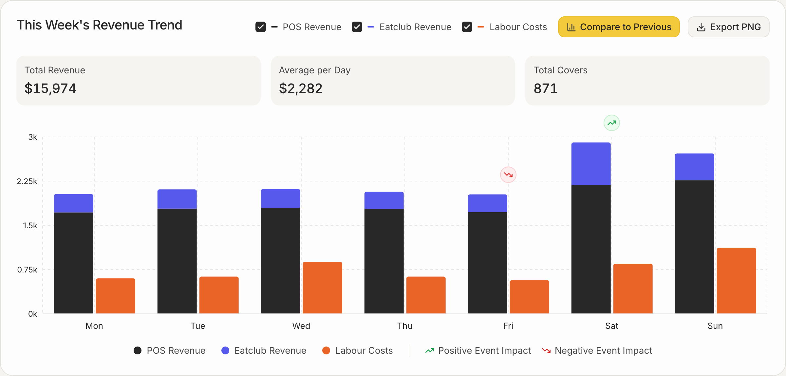
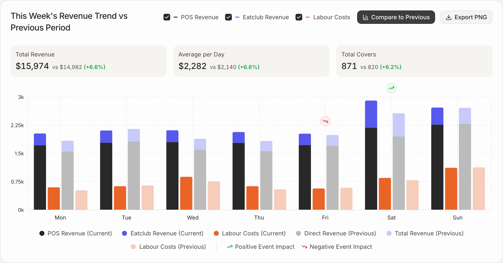
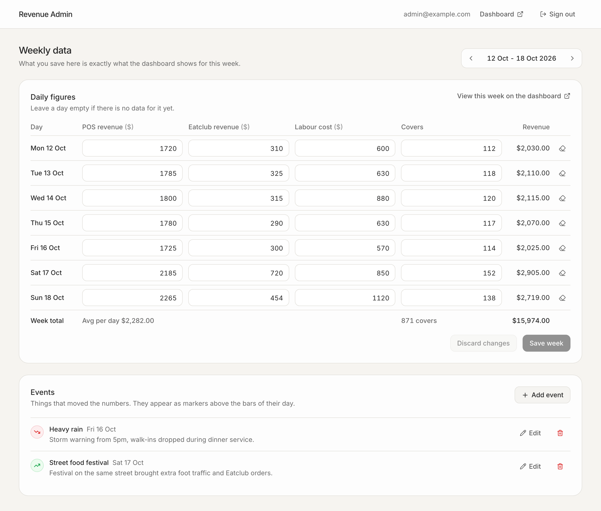

# Revenue Dashboard

A weekly **Revenue Trend** card (rebuilt from the reference video), an **admin area** to manage the data behind it, and a **REST API** that serves exactly what the admin saved.

**Live demo:** https://revenue-dashboard-longvu.vercel.app (admin at [/admin](https://revenue-dashboard-longvu.vercel.app/admin), credentials sent separately). The demo data is reset every night, so feel free to edit anything. Everything below also runs locally, see [Install and run on a fresh machine](#install-and-run-on-a-fresh-machine).

| Dashboard | Compare to previous week |
| --- | --- |
|  |  |



## Contents

1. [What is included](#what-is-included)
2. [Tech stack and project layout](#tech-stack-and-project-layout)
3. [Install and run on a fresh machine](#install-and-run-on-a-fresh-machine)
4. [Check that it works](#check-that-it-works)
5. [Run the tests](#run-the-tests)
6. [API](#api)
7. [Data model](#data-model)
8. [Decisions and assumptions](#decisions-and-assumptions)
9. [Deployment (live demo)](#deployment-live-demo)
10. [Troubleshooting](#troubleshooting)
11. [What I would add next](#what-i-would-add-next)

## What is included

**Frontend view** (`/`), matching the component in the video:

- Title that switches between "This Week's Revenue Trend" and "... vs Previous Period".
- Checkboxes to show or hide **POS Revenue**, **Eatclub Revenue** and **Labour Costs**.
- **Compare to Previous** toggle (yellow when off, dark when on). It adds the previous week's bars in lighter colours and the `vs $14,982 (+6.6%)` comparisons on the KPI cards.
- KPI cards: **Total Revenue**, **Average per Day**, **Total Covers**.
- Bar chart Mon to Sun: POS + Eatclub stacked, Labour Costs next to it, a dashed grid and a `0k / 0.75k / 1.5k / 2.25k / 3k` axis. Bars grow in when they appear.
- **Event markers** (green = positive impact, red = negative) above the day they happened. Hovering a day shows a tooltip with exact values and event details.
- **Export PNG** downloads an image of the card.
- Week navigation (previous / next / latest), empty state for weeks without data, responsive down to phone width.

**Admin** (`/admin`):

- Sign in with email and password. The session is an httpOnly cookie holding a signed JWT. Passwords are hashed with bcrypt. Signing out revokes the session on the server.
- Edit the 7 days of any week: POS revenue, Eatclub revenue, labour cost and covers. The form validates input, previews the totals as you type, asks before you leave the page (or switch week, or sign out) with unsaved changes, and refuses to overwrite numbers another admin saved in the meantime.
- Add, edit and delete the events shown as markers.

**Backend**: Express API with validation, consistent JSON errors and auth on every admin route. It runs on PostgreSQL with Prisma migrations and a seed.

## Tech stack and project layout

| Part | Stack |
| --- | --- |
| Frontend + admin UI | Next.js 16 (App Router), React 19, TypeScript, Tailwind CSS 4, Recharts 3, html-to-image |
| Backend | Node.js, Express 5, TypeScript, Prisma 6, Zod 4, bcryptjs, jsonwebtoken |
| Database | PostgreSQL 14 or newer (developed on 16) |
| Tests | Vitest + Supertest (backend), Playwright (end to end) |

```
revenue-dashboard/
├── backend/                 Express API
│   ├── prisma/
│   │   ├── schema.prisma    tables: users, daily_metrics, events
│   │   ├── migrations/      SQL migrations (applied with `npm run db:migrate`)
│   │   └── seed.ts          admin user + 4 weeks of demo data
│   └── src/
│       ├── routes/          auth, dashboard (public), admin (protected), cron (demo reset)
│       ├── lib/             week maths, totals/percentages, data access, demo data
│       └── middleware/      auth guard, error handler
├── frontend/                Next.js app (dashboard + admin)
│   ├── src/app/             pages: /, /admin/login, /admin
│   ├── src/components/      revenue-trend/ (the card), admin/ (forms)
│   └── e2e/                 Playwright tests
├── docker-compose.yml       optional PostgreSQL in Docker
└── docs/                    screenshots
```

The browser only talks to the Next.js app. Requests to `/api/*` are proxied to the Express API (see `frontend/next.config.ts`), so there is no CORS setup to get wrong and the session cookie works without extra configuration.

## Install and run on a fresh machine

Written for **macOS** and **Ubuntu / Debian**. The Ubuntu path was run end to end in a clean `ubuntu:24.04` container, as a normal user with sudo (PostgreSQL started with `service`, since containers have no systemd), including the unit and e2e tests. You need about 10 minutes and will end up with:

| Service | URL |
| --- | --- |
| Dashboard | http://localhost:3000 |
| Admin | http://localhost:3000/admin (login `admin@example.com` / `admin12345`) |
| API | http://localhost:4000/api/health |

### Step 1. Install the tools (Git, Node.js 24, PostgreSQL)

<details open>
<summary><b>macOS</b></summary>

```bash
# Homebrew (also installs Git through the Xcode Command Line Tools).
# At the end it prints 2 "Next steps" commands: run them.
/bin/bash -c "$(curl -fsSL https://raw.githubusercontent.com/Homebrew/install/HEAD/install.sh)"

# Node.js 24 through nvm
curl -o- https://raw.githubusercontent.com/nvm-sh/nvm/v0.40.3/install.sh | bash
source ~/.nvm/nvm.sh
nvm install 24

# PostgreSQL 16, started now and at every login
brew install postgresql@16
brew services start postgresql@16
echo 'export PATH="'"$(brew --prefix postgresql@16)"'/bin:$PATH"' >> ~/.zshrc
export PATH="$(brew --prefix postgresql@16)/bin:$PATH"
```

</details>

<details open>
<summary><b>Ubuntu / Debian</b></summary>

```bash
sudo apt update
# Installs your distribution's PostgreSQL (16 on Ubuntu 24.04, 14 on 22.04, 15 on Debian 12); 14 or newer is fine
sudo apt install -y git curl ca-certificates openssl postgresql

# Start PostgreSQL (use `sudo service postgresql start` where systemd is not available, e.g. WSL)
sudo systemctl enable --now postgresql

# Node.js 24 through nvm
curl -o- https://raw.githubusercontent.com/nvm-sh/nvm/v0.40.3/install.sh | bash
source ~/.nvm/nvm.sh
nvm install 24
```

</details>

Check:

```bash
node -v    # v24.x
psql --version
```

### Step 2. Get the code

```bash
git clone https://github.com/ItsNLVu/revenue-dashboard.git
cd revenue-dashboard
nvm use    # picks Node 24 from .nvmrc
```

### Step 3. Create the database

Creates the user `revenue` (password `revenue`) and the database `revenue_dashboard`, which match `backend/.env.example`.

**Option A: the PostgreSQL you installed in step 1**

```bash
# macOS
psql postgres -c "CREATE ROLE revenue WITH LOGIN PASSWORD 'revenue' CREATEDB;"
createdb -O revenue revenue_dashboard

# Ubuntu / Debian
sudo -u postgres psql -c "CREATE ROLE revenue WITH LOGIN PASSWORD 'revenue' CREATEDB;"
sudo -u postgres createdb -O revenue revenue_dashboard
```

**Option B: Docker instead of a local PostgreSQL** (only if Docker is installed; skip the PostgreSQL parts of step 1)

```bash
docker compose up -d --wait db
```

### Step 4. Backend: install, migrate, seed, run

```bash
cd backend
cp .env.example .env
# Replace the placeholder JWT secret with a random one
sed -i.bak "s/change-me-to-a-long-random-string/$(openssl rand -hex 32)/" .env && rm .env.bak

npm install          # also generates the Prisma client
npm run db:migrate   # creates the tables (prisma migrate deploy)
npm run db:seed      # admin user + 4 weeks of demo data
npm run dev          # API on http://localhost:4000
```

Leave it running and open a **second terminal** for the frontend.

### Step 5. Frontend: install and run

In the second terminal, go to the folder where you cloned the project, then:

```bash
cd frontend
cp .env.example .env.local
npm install
npm run dev          # http://localhost:3000
```

Open http://localhost:3000. Then go to http://localhost:3000/admin and sign in with `admin@example.com` / `admin12345` (change them with `ADMIN_EMAIL` / `ADMIN_PASSWORD` in `backend/.env` before seeding).

### Production build (optional)

Stop the two dev servers first, then from the project folder:

```bash
# Terminal 1: API on :4000
cd backend
npm run build
npm start
```

```bash
# Terminal 2: frontend on :3000 (API_URL from .env.local is read at build time for the /api proxy)
cd frontend
npm run build
npm start
```

When it is served over HTTPS, start the backend with `NODE_ENV=production npm start` so the session cookie is also marked `Secure`.

### Useful commands

| Where | Command | What it does |
| --- | --- | --- |
| backend | `npm run db:seed` | Re-creates the 4 demo weeks. It overwrites any edits in those weeks and resets the admin password to the one in `.env` |
| backend | `npm run db:reset` | Drops everything, re-applies migrations and the seed |
| backend | `npm run db:migrate:dev` | Creates a new migration after editing `schema.prisma` |
| backend | `npx prisma studio` | Browse the database in the browser |

## Check that it works

1. The dashboard shows **Total Revenue $15,974**, **Average per Day $2,282**, **Total Covers 871** for the current week (the numbers of the video).
2. Click **Compare to Previous**: `vs $14,982 (+6.6%)`, `vs $2,140 (+6.6%)`, `vs 820 (+6.2%)`. Click it again as often as you like: the numbers do not change.
3. In `/admin`, change Monday's POS revenue from `1720` to `2720` and click **Save week**.
4. Click **View this week on the dashboard**: Total Revenue is now **$16,974** and Monday's bar is taller.
5. Add an event for Wednesday: a marker appears above Wednesday's bars.

Run `npm run db:seed` in `backend/` to put the demo data back.

## Run the tests

**Backend tests**:

```bash
cd backend
npm test
```

- Unit and API tests (no database needed): week maths, totals, percentages (division by zero, weeks in progress compared like for like), money rounding, validation, auth guard.
- Integration tests against the database from `backend/.env` (steps 3 and 4 done): saved numbers come back exactly, 24 overlapping saves of the same week all succeed and leave one consistent week, a stale save gets `409`, out of range ids and dates get `400`, sign-out revokes a copied token. They write only to a sandbox week in 2030 and are skipped when `DATABASE_URL` is not set.

**End to end tests** with Playwright, against the running app (steps 4 and 5 done, freshly seeded):

```bash
cd frontend
npx playwright install chromium   # once
npm run test:e2e
```

27 scenarios, including:

- Dashboard: shows the API data, compare mode, numbers stay the same while toggling (and no refetch), checkboxes, event markers and tooltip, Export PNG file, week navigation, empty week, invalid `?week=` values, phone width.
- Admin: redirect when signed out, wrong password, API returns 401 without a session or with a forged cookie, already signed in skips the login form, sign-out revokes a copied cookie, login then return to the requested page, validation messages, saved values shown exactly on the dashboard (cents included), clearing a day, unsaved changes warning, conflict with another admin's save, a week in progress compared with the same days of the previous week, events add / edit / delete.

The e2e tests write only to sandbox weeks in 2029/2030 and clean them up afterwards. Use `E2E_BASE_URL` if the app runs on another port.

## API

All responses are JSON. Errors always look like `{ "error": { "code", "message", "details?" } }`. Every `/api` response has `Cache-Control: no-store`.

| Method | Path | Auth | Description |
| --- | --- | --- | --- |
| GET | `/api/health` | | Health check |
| POST | `/api/auth/login` | | `{ email, password }`, sets the session cookie |
| POST | `/api/auth/logout` | | Revokes the session (all tokens issued so far) and clears the cookie |
| GET | `/api/auth/me` | yes | Current admin |
| GET | `/api/dashboard/weekly?weekStart=YYYY-MM-DD` | | Everything the card needs (see below) |
| GET | `/api/admin/metrics?weekStart=` | yes | The 7 days of a week, plus a `version` fingerprint |
| PUT | `/api/admin/metrics` | yes | `{ weekStart, baseVersion?, days: [...] }` replaces the week in one transaction. Days left out are cleared. `409` if `baseVersion` no longer matches |
| GET | `/api/admin/events?weekStart=` | yes | Events of a week |
| POST | `/api/admin/events` | yes | `{ date, impact: "positive" \| "negative", title, description? }` |
| PATCH | `/api/admin/events/:id` | yes | Any subset of the fields above |
| DELETE | `/api/admin/events/:id` | yes | Deletes an event |

`weekStart` must be a Monday between 2000 and 2099. Without it, `/api/dashboard/weekly` returns the current week (or the latest week that has data, reported as `defaultWeekStart`) and the admin routes use the current week. Admin routes accept the session cookie or an `Authorization: Bearer <token>` header.

Example `GET /api/dashboard/weekly?weekStart=2026-10-12` (shortened):

```json
{
  "weekStart": "2026-10-12",
  "isCurrentWeek": true,
  "defaultWeekStart": "2026-10-12",
  "availableWeeks": ["2026-10-12", "2026-10-05", "2026-09-28", "2026-09-21"],
  "current": {
    "weekStart": "2026-10-12",
    "weekEnd": "2026-10-18",
    "hasData": true,
    "days": [
      { "date": "2026-10-12", "dayLabel": "Mon", "posRevenue": 1720, "eatclubRevenue": 310,
        "labourCost": 600, "covers": 112, "revenue": 2030, "hasData": true }
    ],
    "totals": { "revenue": 15974, "avgPerDay": 2282, "labourCost": 5280, "covers": 871, "daysWithData": 7 }
  },
  "previous": { "weekStart": "2026-10-05", "days": ["..."], "totals": { "revenue": 14982, "avgPerDay": 2140.29 } },
  "comparison": {
    "previous": { "revenue": 14982, "avgPerDay": 2140.29, "labourCost": 4990, "covers": 820, "daysWithData": 7, "hasData": true },
    "revenuePct": 6.6, "avgPerDayPct": 6.6, "coversPct": 6.2
  },
  "events": [
    { "id": 2, "date": "2026-10-17", "dayLabel": "Sat", "impact": "positive",
      "title": "Street food festival", "description": "Festival on the same street brought extra foot traffic and Eatclub orders." }
  ]
}
```

Try it with curl:

```bash
curl -s localhost:4000/api/dashboard/weekly | head -c 400
curl -s -c /tmp/rd.txt -H 'content-type: application/json' \
  -d '{"email":"admin@example.com","password":"admin12345"}' localhost:4000/api/auth/login
curl -s -b /tmp/rd.txt localhost:4000/api/auth/me
curl -s -b /tmp/rd.txt "localhost:4000/api/admin/events?weekStart=2026-10-12"
```

## Data model

```
users          id, email (unique), password_hash, session_version, created_at
daily_metrics  id, date (DATE, unique), pos_revenue, eatclub_revenue, labour_cost  NUMERIC(12,2), covers INT, updated_at
events         id, date (DATE, indexed), impact ENUM(positive, negative), title, description, created_at, updated_at
```

One row per day keeps the admin simple and lets any week, or the previous one, be read with a date range.

## Decisions and assumptions

- **Exact data, no randomness.** In the reference video the numbers change every time "Compare to Previous" is clicked (16,977, then 16,469, 16,110...), so the demo uses random data. The task asks that the frontend reflects *exactly* what the admin saved, so here all numbers come from the database, toggling never changes or refetches them (an e2e test checks this), and API responses are never cached.
- **Seed = the video.** The current and previous seeded weeks reproduce the figures visible in the video: $15,974 vs $14,982 (+6.6%), $2,282 vs $2,140, 871 vs 820 covers (+6.2%).
- **Formulas.** Revenue = POS + Eatclub (labour is a cost, not revenue). Average per day = revenue / number of days entered. Percentages are rounded to one decimal and shown as "n/a" when the previous value is 0. Totals are computed on the backend in integer cents, so the dashboard and the API can never disagree.
- **Previous period** = the 7 days before. Weeks run Monday to Sunday. "Current week" is decided by the backend only (the frontend never guesses it), in `APP_TIMEZONE` when set (the live demo uses `Asia/Ho_Chi_Minh`), otherwise in the server's timezone.
- **Weeks in progress.** A day is either fully filled in or left empty (= no data yet, not $0). Empty days get no bars and say "No data entered" in the tooltip. If only Mon to Wed are entered, the comparison uses Mon to Wed of the previous week, so the KPIs do not show a fake drop in the middle of the week; the card says "3 of 7 days entered so far".
- **Legend names.** The video labels the previous week's series "Direct Revenue (Previous)" and "Total Revenue (Previous)". I kept those legend labels to match the design; they are the previous week's POS and Eatclub figures, and the tooltip uses the plain names ("POS Revenue", "Eatclub Revenue") to avoid confusion.
- **Concurrent edits.** Saving a week takes a per-week lock in Postgres, so overlapping saves cannot deadlock or mix two versions. The form sends the version it loaded; if someone else saved in between, the API answers `409` and the form offers to load the latest numbers instead of silently overwriting them.
- **Y axis** uses "nice" steps (2,905 rounds up to 3k in 0.75k steps, as in the video) computed from both weeks. That way the axis does not jump when series are toggled.
- **Security.** Admin routes are protected on the server; the Next.js redirect is only a convenience. The cookie is httpOnly + SameSite=Lax (+ Secure with `NODE_ENV=production`). Each request checks the token against the user's `session_version`, so signing out (or deleting the user) invalidates every token at once. The login does not reveal whether an email exists, and after login it only redirects inside `/admin`.
- The four tabs under the card in the video (Period Comparison, Year-over-Year, ...) belong to another part of that page and are out of scope.

## Deployment (live demo)

| Part | Where | Notes |
| --- | --- | --- |
| Frontend | Vercel project `revenue-dashboard` (root `frontend/`, region Singapore) | `API_URL` points to the API project; `/api/*` is proxied to it, so the session cookie stays first-party |
| API | Vercel project `revenue-dashboard-api` (root `backend/`, region Singapore) | Zero-config Express: Vercel runs the app exported by default from `src/app.ts` |
| Database | Neon PostgreSQL, AWS Singapore | The API uses the pooled connection string (`pgbouncer=true`); migrations ran with the direct one |

Environment variables of the API project: `DATABASE_URL`, `JWT_SECRET`, `ADMIN_EMAIL`, `ADMIN_PASSWORD`, `APP_TIMEZONE`, `CRON_SECRET`. The demo admin password is not the one in `.env.example`.

`backend/vercel.json` schedules a daily [Vercel Cron](https://vercel.com/docs/cron-jobs) call to `GET /api/cron/reset-demo` (00:01 Vietnam time, within Hobby's 1 hour window). It puts the demo weeks back for the current week and removes whatever visitors changed. The route only exists when `CRON_SECRET` is set and checks the `Authorization: Bearer <CRON_SECRET>` header that Vercel sends, so it is disabled locally.

To deploy your own copy: create a Neon database, run `npm run db:migrate` and `npm run db:seed` against it, then deploy `backend/` and `frontend/` as two Vercel projects with the variables above (`vercel deploy --prod` in each folder). The whole e2e suite also runs against the live URL: `E2E_BASE_URL=<url> E2E_ADMIN_PASSWORD=<password> npm run test:e2e`.

## Troubleshooting

| Problem | Fix |
| --- | --- |
| `P1001: Can't reach database server` | PostgreSQL is not running: `brew services start postgresql@16`, `sudo systemctl start postgresql` or `docker compose up -d db`. |
| `password authentication failed for user "revenue"` | Step 3 was skipped or `DATABASE_URL` in `backend/.env` does not match. |
| Port 5432 already used (Docker option) | `POSTGRES_PORT=5433 docker compose up -d db` and use port 5433 in `DATABASE_URL`. |
| Port 3000 or 4000 already used | Frontend: `npm run dev -- -p 3001`. Backend: set `PORT=4001` in `backend/.env` and `API_URL=http://localhost:4001` in `frontend/.env.local`, then restart both. |
| Dashboard says "Could not load the dashboard" | The backend is not running, or `API_URL` points to the wrong port. |
| `Missing required environment variable JWT_SECRET` | `backend/.env` is missing: `cp .env.example .env` (step 4). |
| npm 11 warns about install scripts | Already handled: the needed packages are listed in `allowScripts` in each `package.json`. |

## What I would add next

- Rate limiting and lockout on the login endpoint, and an audit log of who changed which numbers.
- Multiple venues and admin users with roles.
- Import from the POS / Eatclub systems instead of manual entry.
- The other tabs of the page (year-over-year, budget performance).
- A `docker compose up` that runs the whole stack, and CI running the unit and e2e tests on every push.
